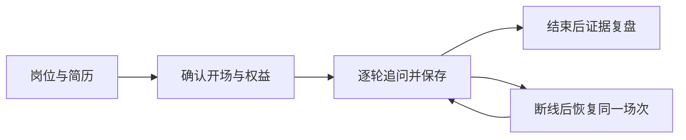

# 面试能力与实现索引

当前规则和业务边界以 [Agent.md](Agent.md) 为准，图节点与取消链路见 [执行流程](agent_execution_workflow.md)。

| 能力 | 入口与职责 |
| --- | --- |
| 简历读取 | `InterviewService` 优先读取本人文本快照，必要时交给 `DocumentParserService` 解析文件 |
| 简历押题 | `InterviewQuizService` 管理幂等、权益和结果；`InterviewAIService` 调用模型 |
| 模拟开场 | `InterviewStartService` 保存岗位与简历快照、确认权益；开场为本地模板 |
| 面试追问 | `InterviewAgentService` 按简历、专业、行为和反问阶段真实流式生成，角色均为模拟面试官麦麦 |
| 回合与恢复 | `InterviewTurnService` 处理归属、版本、租约、保存、重放、暂停与恢复 |
| 复盘 | `InterviewReportService` 保存证据评分结果；评分规则由 `assessment-rubric.ts` 与 `assessment-output.ts` 定义 |
| 语音 | `InterviewSpeechService` 统一识别和合成入口，供应商及转码由对应服务处理 |
| 代码题 | 静态分析候选人代码、边界和验证思路，不运行代码，不声称测试通过 |

原本机 Node 代码执行器已移除。进程超时和输出大小限制不等于隔离环境；后续若需要运行代码，须独立设计执行服务并验收权限边界。

单元测试、受控供应商集成和真实模型验收的范围不同；任何一项通过都不能代替其他项。真实模型记录见根 `docs` 中的验收说明。
