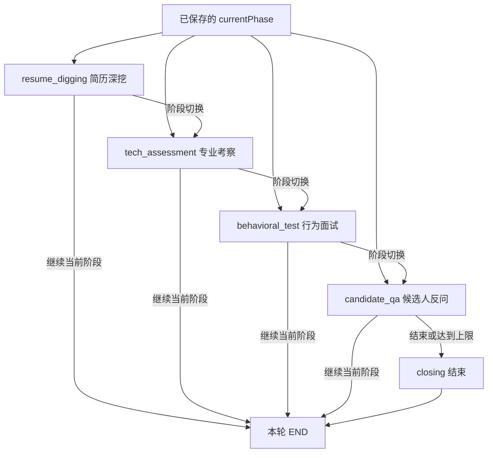

# 面试 Agent 执行与流转

本说明对应 `InterviewAgentService`。开场、权益、回合持久化和复盘的职责见 [Agent.md](Agent.md)，不在图节点内重复实现。

## 状态图

每轮按已保存的 `currentPhase` 进入图；同阶段追问完成后返回 END，下一轮由持久化快照恢复。

`introduction` 是兼容节点，输出本地模板后将阶段设置为 `resume_digging`；正常开场由 `InterviewStartService` 确认和保存。综合／行为面试可以直接从 `behavioral_test` 开始。

## 执行顺序

1. `InterviewTurnService` 校验归属、版本和请求幂等性，领取回合租约。
2. `generateInterviewQuestionStream` 恢复历史和阶段。消息超过 15 条时，摘要较早历史并保留最近 4 条；摘要不能保证消除遗漏或模型幻觉。
3. 阶段裁判对照最新问题和回答判断是否切换；强度对应的追问上限仍生效。代码回答可继续围绕逻辑和边界追问。
4. 简历、专业、行为与反问节点使用模型真实 stream，将增量文本经回调、AsyncQueue、Subject 和 SSE 发送。固定模板立即发送，不额外模拟打字等待。
5. 图完成后，回合服务核对完整输出并按租约保存回答、下一题及阶段。保存成功后才发送终态问题与 waiting／end；部分文字不代表回合已确认。
6. 同请求重试重放已保存事件，不再次调用模型；失败保留草稿，既有快照用于恢复。

## 超时与取消

回合的 90 秒超时会触发 AbortController，并将 signal 传到图、阶段裁判、历史摘要及模型 stream／invoke。已经缓冲的旧 token 也受取消检查，不能在取消后继续作为成功结果返回。

供应商是否立即停止计算以其实现为准。对于忽略取消的上游，仍由 active 标记和持久化租约阻止迟到事件与旧结果落库。客户端断线不等于取消整个业务回合；保存结果后可恢复或重试同请求确认。

## 代码分析边界

当前只阅读代码文本，不绑定代码执行工具，不在后端机器运行候选人代码，也不能声称通过了运行测试。原本机 Node 子进程执行器已移除：清除全局 process／require 不构成安全隔离。未来执行能力需要独立隔离环境及明确的资源、文件和网络边界，再单独设计与验收。

## 验证入口

- `test/interview/interview-agent.spec.ts`：首段提前输出、完整问题、代码静态分析、取消与阶段裁判。
- `test/interview/interview-turn.spec.ts`：超时信号、拒绝迟到保存、幂等及状态边界。
- `test/integration/turn-recovery.cjs`：专用 Mongo、JWT、HTTP/SSE、真实图节点与受控 SDK stream；可设置 `TEST_PROXY_BASE` 检查 Next 代理提前透传。
