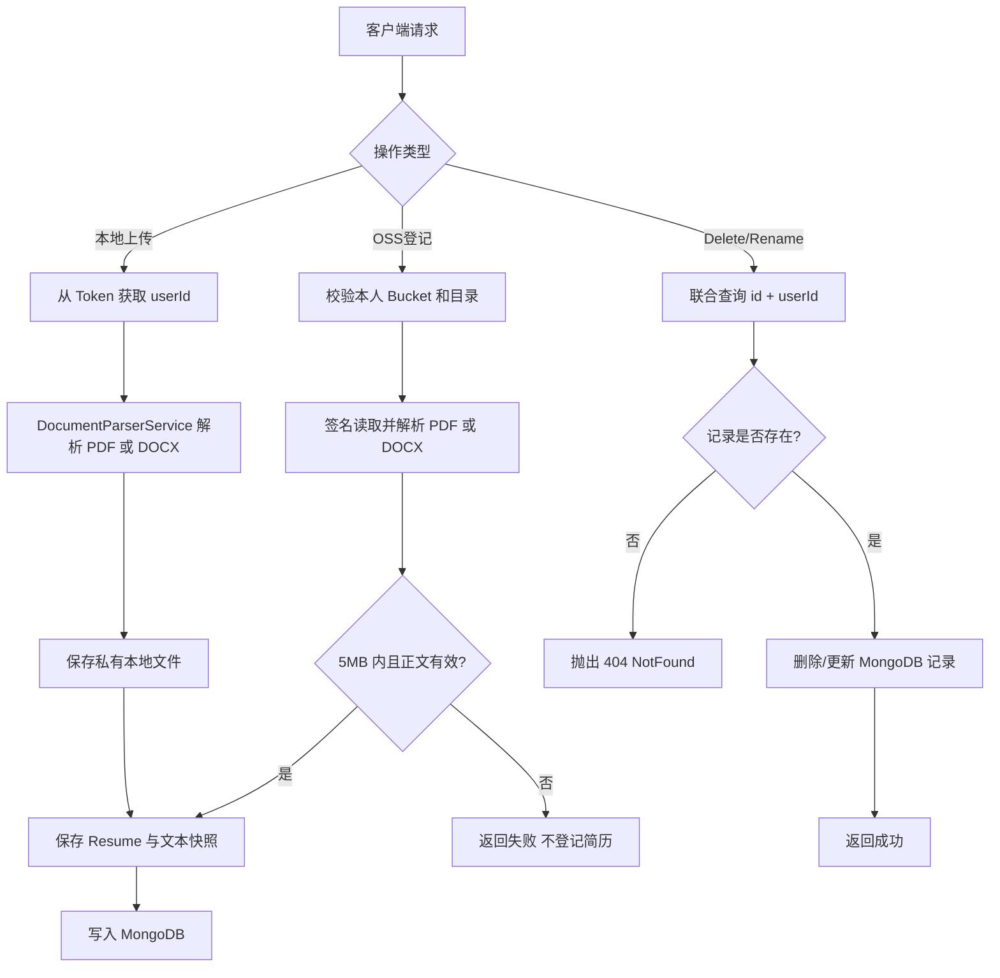

# Backend Module: Resume Metadata Management (简历信息存储管理)

## 1. 业务功能概述 / Business Functionality
- **核心业务逻辑**: 提供本地文件上传、OSS 元数据登记、在线简历和文本快照管理；支持列表、详情、重命名及删除。
- **核心数据结构**:
  - `Resume` Schema (MongoDB): 包含 `userId` (关联用户), `resumeName` (简历名), `url`（可选的 OSS 文件链接）、`localFileKey`（可选的本地文件标识）、`plainTextSnapshot` 和 `uploadTime`。

## 2. 核心业务流程图 / Core Business Workflows (Mermaid)

## 3. 架构设计与代码流转 / Architectural Workflow
- **控制器 (ResumeController)**:
  - 文件：`resume.controller.ts`
  - 核心接口（全部路由均受 `JwtAuthGuard` 认证保护）：
    - `GET /resume/getInterviewResumeList`: 获取当前登录用户的所有简历列表。
    - `GET /resume/upload-config`: 获取 local／oss 及大小限制。
    - `POST /resume/upload-file`: JWT 单文件 multipart，本地 5MB 上限，解析后保存快照。
    - `POST /resume/uploadResume`: 用户上传简历文件后，将文件的 OSS URL 关联记录到数据库。
    - `POST /resume/deleteResume`（body: resumeId）: 删除简历元数据。
    - `POST /resume/updateResumeName`（body: resumeId、resumeName）: 对指定简历进行重命名。
- **简历服务 (ResumeService)**:
  - 文件：`resume.service.ts`
  - 核心逻辑：操作 MongoDB `resumeModel` 进行增删改查。当删除或修改不存在的简历时，抛出 NestJS 自带的 `NotFoundException` (404 状态码)。
- **控制流向 / Data Flow**:
  1. 前端通过 `upload-config` 选择上传方式。
  2. local 模式直接发送 multipart 到 `upload-file`，后端解析、写入私有文件及快照；oss 模式先上传文件，再向 `uploadResume` 登记 `{ resumeName, url, uploadTime }`。后端验证 URL 归属，使用 STS 签名读取并按 5MB 限制解析，校验正文后才保存 `plainTextSnapshot`、`sourceType=upload`、`status=ready`；读取或解析失败不会登记空白简历。
  3. `ResumeController` 拦截并校验，提取 Token 中的 `userId`。
  4. `ResumeService` 创建简历数据模型记录并保存落库。
  5. 进行简历列表查询时，按 `createdAt` 降序返回给前端。

## 4. 技术依赖与第三方 API / Tech Stack & External APIs
- **核心依赖**: `@nestjs/mongoose`, `mongoose`
- **注意**: 本模块主要处理**元数据**。实际的简历文件文本抽取（PDF/Word 文本提取）由共享的 `DocumentParserModule` 导出的 `DocumentParserService` 负责，上传和面试复用同一解析器。

## 5. 开发约束与边界处理 / Constraints & Guidelines
- **数据隔离**: 在进行任何删、改、查操作时，必须在 Query 中强制限制 `userId`！绝对禁止横向越权操作其他用户的简历记录（即：不能只通过 `resumeId` 去删改数据，必须同时校验 `userId`）。
- **校验**: 简历名更新和上传时，简历名不能为空且字数不能过长。

## 6. 本地调试与排查 / Debugging & Verification
- **调试方式**:
  - 用 Postman 或 Swagger 挂载 Bearer Token。
  - 调用 `GET /resume/getInterviewResumeList`，检验是否能够准确检索出当前测试用户的专属简历列表。
- **异常排查**:
  - 如果返回 `404 简历不存在`：检查是否由于传入 of `resumeId` 与该 Token 解析出的 `userId` 不匹配（越权或ID有误）。

- 重命名/删除 DTO 校验 MongoDB ID，重命名去除首尾空白并拒绝空名称；编辑内容要求对象结构。所有查询、保存与删除继续限定所属用户。本地文件在删除记录后清理；OSS 仍只删除元数据。文件与 Mongo 不共享事务，清理失败记录告警，当前没有后台回收。配置与验证入口见 [评分与本地上传说明](../../../../docs/interview-scoring-and-local-upload.md)。
