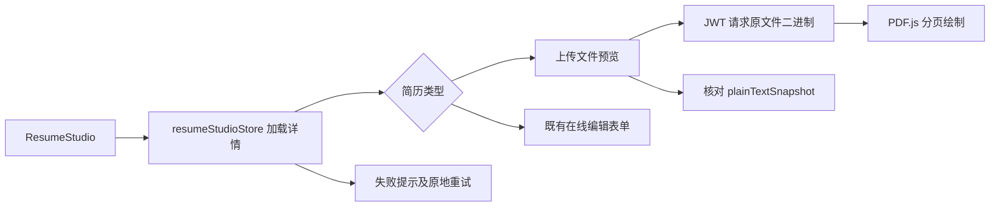

# 简历查看与编辑模块

上传型简历由 `studio/UploadedResumePreview.tsx` 展示两个独立视图：原始排版、面试官使用的提取文字。在线编辑型简历继续走既有 `ResumeStudio` 表单。

`GET /resume/file/:id` 经统一代理和 Authorization 获取 Blob；浏览器对象 URL 在取消、换简历或卸载时回收。不得把访问令牌或签名地址放进 iframe URL。详情失败必须结束加载并允许重试。

PDF 使用 `PdfResumePreview` 在浏览器本地绘制当前页，页码控制、错误重试和尺寸变化均保留反馈；Canvas 的替代文字引导到可读取的提取内容。DOCX 提供下载和提取内容，不伪装成 Word 原始排版。历史记录无快照时明确提示重新上传，不显示假内容。

`pnpm dev:web` / `pnpm build:web` 会执行 `scripts/copy-pdf-assets.mjs`，将锁定版本的 PDF.js 主模块、Worker、字符映射、字体与解码器复制到忽略入库的 `public/pdfjs/`。主模块使用原生 ESM，避免 Next 14 对 PDF.js 与 Worker 的构建转换产生不兼容；无 CDN 和外部简历查看服务。修改依赖版本后必须重新生成资源。

回归入口：`test/store/resumeStudioStore.spec.ts`、`test/api/backend-proxy.spec.ts`、`e2e/usability.spec.ts`。原始文件接口只负责查看，删除简历的 OSS 对象回收策略保持既有约束。
