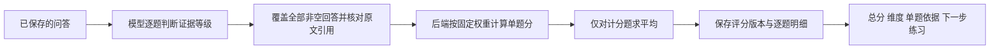

# 面试评分与本地上传

## 借鉴了什么

| 来源 | 可复用经验 | 本项目的落实 |
| --- | --- | --- |
| [OPM：自定义结构化面试评分量表](https://www.opm.gov/frequently-asked-questions/assessment-policy-faq/structured-interviews/how-do-i-develop-a-customized-rating-scale-for-structured-interviews/) | 先定义等级、行为示例及每题评分方法；需要专业人员参与校准 | 固定五级证据锚点；数学汇总与模型判断分开，保留明确版本 |
| [DeepInterview](https://github.com/ngoanpv/DeepInterview/blob/main/packages/shared/schema/ScoreCard.json)、[RubricItem](https://github.com/ngoanpv/DeepInterview/blob/main/packages/shared/schema/RubricItem.json) | 能力分、证据、权重与考察覆盖度共同构成报告 | 每题原文证据、固定维度权重、计分题数、具体练习动作 |
| [Yoodli：面试官训练](https://yoodli.ai/use-cases/interviewer-training) | 按统一面试指南与量表练习，并反馈提问、追问与评分 | 同类练习使用相同量表；前端显示分数来源和逐题拆分 |

以上借鉴的是可验证的方法与结构。这些来源不证明本项目已具备其全部能力或评分准确率。多岗位人工标注、题目难度校准及后续 Agent／Jev 升级仍属于后续工作。

## 新报告的评分链路



评价标准为 `interview-rubric-v2`。模型只输出每题四个维度的 1–5 级判断及反馈，不能直接指定最终总分。

| 维度 | 专项面试 | 综合／行为面试 |
| --- | ---: | ---: |
| 切题与覆盖 | 30% | 25% |
| 方法与判断 | 35% | 20% |
| 深度与依据 | 20% | 35% |
| 表达与结构 | 15% | 20% |

五级锚点依次对应 20、45、65、85、100 分：明显跑题或关键错误；部分相关但核心缺口大；核心基本正确；正确具体、解释清楚；准确深入且能说明相关边界与取舍。映射与权重是本项目的练习规则，尚非经过人群数据校准的行业量表。

单题分 = 已观察维度的「分数 × 权重」之和 ÷ 已观察权重之和，四舍五入；总分 = 各计分题的平均值，四舍五入。60／80／90 分分别进入基本达标／良好／优秀。不同考察深度的场次不宜只按总分排名。

- 未观察的维度为 null，不按零分处理。候选人反问和纯流程性对话不计分；只有这些对话时不产生能力总分。
- 每条非空回答必须覆盖，重复题号、遗漏弱回答、非法等级及引用不符会使生成明确失败，保留原问答。
- 原理题不强求 STAR、业绩或线上数据；经历题考察具体职责、行动和结果。正确的简短回答可高分，文本不能用于推断真实语音流畅度。
- 新报告保存 `reportQuestionAssessments`、`reportScoring` 和版本。旧报告保持可读，不批量修改已有分数，不自动对已完成报告重新收费或调用模型。

## 本地文件上传


默认 `RESUME_STORAGE_DRIVER=local`，使用现有依赖，没有增加上传 SDK。`GET /resume/upload-config` 返回所选方式；`POST /resume/upload-file` 接收名为 `file` 的单文件表单。原 OSS 登记接口继续保留，现会先解析、校验正文，再保存快照。

`RESUME_LOCAL_DIR` 可设为绝对目录；不设置时使用后端工作目录下的 `data/resumes`。根开发命令对应 `apps/server/data/resumes`。目录和文件分别以 0700／0600 创建，文件名使用随机 ID 并按用户隔离，没有静态文件公开路由。数据库保存失败会清理新文件。删除本地简历会清理原文件，已有面试使用的文本快照仍保留；Mongo 与文件系统不共享事务，删除后的文件清理失败会告警，当前没有后台孤立文件回收器。

设置 `RESUME_STORAGE_DRIVER=oss` 并填写 `.env.example` 所列 OSS／STS 配置，重启后端即可使用云端上传路径。浏览器通过临时凭证上传；后端登记时验证用户目录，以短期签名读取并解析文件，按 5MB 上限校验后保存文字快照及 ready 状态。签名 URL 不写入数据库，文件不可读或正文无效时明确报错，不登记空白简历。即使 Bucket 开启阻止公共访问，已授权 STS 和签名读取仍可工作。本地历史快照继续可用；原文件不自动迁移。文件和数据库需一起保留。扫描件、加密或损坏文件会拒绝或解析失败，当前没有 OCR。

OSS 上传后登记失败或删除元数据时，云端文件当前不会自动清理；正式运营前需补充孤立文件回收。开启原素材 Bucket 的阻止公共访问也会影响匿名图片直链，简历链路验收不代表所有旧素材已适配。

## 验收与复现

2026-11-02 另行完成 OSS 真实验收：复用原 Bucket，匿名文件读取返回 403；JWT／STS、PDF／DOCX 上传、签名读取和真实解析、文字快照、用户归属拒绝、坏文件拒绝，以及 Next 代理后的浏览器直传／CORS、390px 显示均通过。只用合成样例，云端测试文件与专用测试数据库已清理；没有模型或支付调用，没有部署生产环境。该结果不代表此前仅测本地上传的轮次也验收了 OSS。

复测入口 `apps/server/test/integration/resume-oss.cjs` 需先构建后端、启动专用 MongoDB 的 27028 端口，并在 `apps/server/.env.development` 配好 OSS／STS。脚本只读取其中的 OSS 配置，不使用开发数据库；会写入随机测试用户目录并在结束时清理。运行命令如下：

```bash
cd apps/server
NODE_ENV=test RUN_OSS_INTEGRATION=1 \
  MONGODB_URI=mongodb://127.0.0.1:27028/msm_oss_acceptance \
  JWT_SECRET=synthetic-oss-acceptance-secret-only \
  DEEPSEEK_API_KEY=synthetic-not-called PAYMENT_MODE=disabled \
  node test/integration/resume-oss.cjs
```

可选设置 `TEST_WEB_BASE=http://localhost:8011`，使用已启动且 `BACKEND_API_URL=http://127.0.0.1:3017` 的测试前端，追加浏览器上传验收。复测需要真实 OSS 读写及清理权限，会产生少量云端请求。

- 自动测试覆盖汇总公式、优秀等级、缺失维度、非计分题、引用和覆盖校验，以及本地真实 PDF／DOCX、文件权限、坏文件、保存失败清理与磁盘错误。
- `test/integration/resume-local.cjs` 使用专用 `127.0.0.1:27028/msm_resume_acceptance`，验证真实注册／JWT、文件上传、越权、超限、面试快照、报告持久化及删除。模型明确 Stub，不能据此判断模型质量。
- 同一脚本的 `TEST_WEB_BASE=http://127.0.0.1:8011` 模式验证真实 Next 代理和 Playwright 桌面／390px 窄屏：上传、提取预览、总分、评分说明和逐题维度。测试 Next 后端需指向本地 3017。
- 独立真实模型回归入口如下，只调用三次，无数据库：

```bash
pnpm build:server
RUN_SCORING_LIVE=1 node --env-file=apps/server/.env.development apps/server/test/harness/scoring-live.cjs
```

`scoring-cases.json` 是固定的人工编写合成问答，包含较充分回答、跑题回答和准确深入回答（附候选人反问）。验收区间预先固定，不要求同一句话每次完全同分；失败时先看原文、等级与反馈，不自动放宽区间。实际会产生供应商用量，默认单元测试／CI 不调用。

2026-11-02 的回归输出为 88／34／97，分别为良好／需加强／优秀，反问题无分且不影响总分，引用与覆盖校验通过。此前相同规则抽样为 86／30／99，存在模型波动；三例不是标准化准确率证明。云端 OSS、生产发布和真人录音未包含在本轮验收中。
